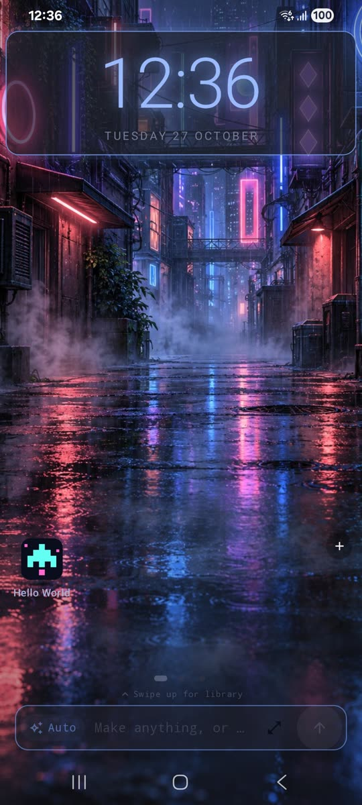
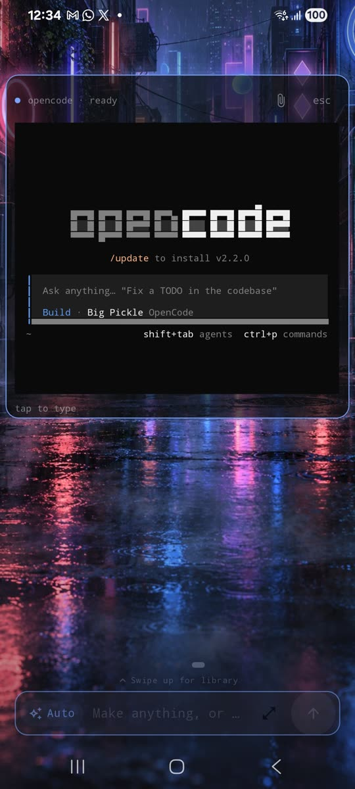
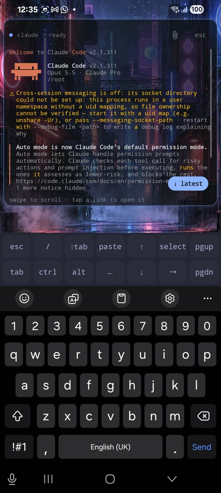

<p align="center">
  
</p>

<h1 align="center">Hatchlybox</h1>

<p align="center"><b>Say it. Hatch it.</b></p>

<p align="center">
  Describe an app or a game, and AI builds it, installs it and keeps it in one library across all your devices.
</p>

<p align="center">
  <a href="../../releases">Download</a> ·
  <a href="#getting-started">Getting started</a> ·
  <a href="#features">Features</a> ·
  <a href="app/src/main/assets/legal/PRIVACY.md">Privacy</a> ·
  <a href="CHANGELOG.md">What's new</a> ·
  <a href="https://github.com/sponsors/HatchlyBox">Sponsor</a>
</p>

<p align="center">
  <a href="https://github.com/HatchlyBox/hatchlybox-android/releases"></a>
  <a href="LICENSE"></a>
  
  <a href="https://github.com/HatchlyBox/hatchlybox-android/discussions"></a>
</p>

https://github.com/user-attachments/assets/d24f6618-9ae8-4f4d-b49b-aa635f56983c

<p align="center">
  <sub>Asked to “open Hello World and play”, an AI helper opens Neon Run, a game it made on this phone, and plays it.
  The start is at 2× speed, the game at real speed.</sub>
</p>

<p align="center">
  
  
  
</p>

---

Hatchlybox makes apps and games from what you describe, on Android, Linux, macOS and Windows. Type what you want,
such as *"a budget tracker with a pie chart"* or *"a neon racing game"*, and an AI helper (Claude Code, Codex or
OpenCode) writes it, builds it and installs it on the device you're using. Ask for changes the same way.

**Say it → it's built → it's installed → it can use it.** Hatchlybox for Android can also use the phone on its own,
when you allow it: open the app it just made and try it out, play a game, or get something done in your other apps,
with a gold cursor showing every tap and a Stop button always in reach.

Then ask for the same creation on another system: the Android app gets its Linux, macOS, Windows or web version.
Everything you make lives in one library, synced between your phones and computers.

| | Phone (Android) | Computer (Linux, macOS, Windows) |
| --- | --- | --- |
| Create and change by describing | ✓, on the phone itself | ✓ |
| Makes versions for | every system | every system |
| Installs and runs here | Android apps, web apps | that computer's apps (Android ones go to your phone by QR code) |
| Library synced across devices | ✓ | ✓ |
| Also | a home screen with widgets and themes, actions on the phone | a desktop page in the browser |

No Hatchlybox account, no analytics, no server of ours in between. The AI helper runs under **your own** account.

## Features

### Create anything, for any system
- **Apps, games and widgets** from plain words, made and installed on the phone. No computer, no coding.
- **Games with Godot**: 2D and 3D games, exported for Android, Linux, macOS and Windows.
- **Change anything later**: "make the buttons bigger", "add a dark mode". Every change waits for you to keep it
  or throw it away.
- **One creation, every system**: make an Android app, then ask for its Linux, macOS, Windows or web version.
- **Your choice of AI helper**: Claude Code, Codex or OpenCode, signed in with your own account. Or just chat
  with it in the create box.

### One library, all your devices
- **Sync** your creations between your phone and computers: pair once with six digits or a QR code. It's
  end-to-end encrypted and goes straight from device to device.
- **Hatchlybox on computers**: the same engine with a desktop page in your browser, on Linux, macOS and Windows
  (through WSL).
- **GitHub, if you want**: keep any creation in your own private repository.
- **Google Play, if you want**: publish a creation to the Play Store from the app.

### On Android: a home screen that's yours
- **Widgets** for weather, battery, headlines, system, water, agents' status and more, or describe a new one.
- **Themes and 23 painted backgrounds**, with opacity you choose and pages you drag into order.
- **Web apps**: share any site from your browser to Hatchlybox, and it becomes an app with its own icon.
- **Quick actions** from the create box: "open maps", "call Ana", "timer 5 min".
- **Reminders** in words ("remind me at 6 to call mum"), kept by Hatchlybox or saved to your calendar.

### On Android: AI helpers right on your home screen
- **Claude Code, Codex or OpenCode as a widget**: long-press the home screen, **Add a widget › Agents**, and pick
  one. It's the real command-line tool in a full terminal on your home screen, ready to type to, with a key bar
  over the keyboard for Tab, Esc, Ctrl and the arrows.
- **It carries on where you left off**: after an update or a restart, the helper picks up its last conversation.
- **A plain terminal** too (**Add a widget › Terminal**), with Hatchlybox's own Linux (Alpine) behind it.
- **Or just chat**: the create box's Chat mode talks to the same helpers, and the conversation keeps going while
  you do something else.

### On Android: hands on your phone
Hatchlybox can do things on the phone for you, and so can your AI helper, but only as far as you allow.

- **Ask in words, and it acts**: "text Ana I'm late", "close YouTube", "turn on the flashlight". A small on-device
  model (Google's FunctionGemma, offline, about a second) turns what you type into an action, and you tap it.
- **Teach it new actions**: describe one ("tell me the next bus from my stop") and an AI helper builds it.
- **Actions in other apps**: with Hatchlybox switched on in Android's **Accessibility** settings, it can press
  Send in WhatsApp, close apps, take screenshots and lock the phone. It reads the screen only while your action
  runs, and keeps nothing.
- **Hands on for AI helpers**: with Accessibility on, an agent can also use the phone the way you do: read what's
  on the screen, then tap, type and scroll in any app, including the apps and games it made for you, to check they
  work (as in the video above). It thinks before every move, so fast arcade games are still a stretch. It asks you first each time, and your yes lasts 30 minutes.
  A gold cursor shows every place it looks or taps, and a **Stop** button at the top ends it at once. When a
  choice is yours (a size, an address, pickup or delivery), it asks you in a notification instead of guessing.

**The safeguards** are built into the app's code, not just told to the AI, so text on a web page or in a message
can't talk an agent past them:
- Safe actions run straight away. Others need your tap. Sensitive ones (calls, messages, uninstalling) also
  need your fingerprint, face or screen lock.
- An agent never presses the final button of a payment, never types a password or card number, and never
  touches Hatchlybox's own screens, Android's permission screens or the Accessibility settings.
- Nothing happens while the phone is locked, and an agent stuck tapping the same spot is stopped.
- Every action, by you or by an agent, goes in the **action log** (Settings › Actions): what it was, who asked
  and how it went.

> **Please read:** AI helpers can misunderstand you or make mistakes. Hatchlybox has the safeguards above, but no
> safeguard catches everything. You choose whether to switch these features on and what to allow, and you're
> responsible for actions you allow on your phone and accounts. The Hatchlybox project and its contributors are
> not responsible for what an AI helper or an automated action does. Hatchlybox comes with no warranty (see the
> [licence](LICENSE)). Keep an eye on the gold cursor and the action log, and tap **Stop** whenever something
> looks wrong.

### You decide what's on
Every feature that does something on its own can be switched on or off at any time in Hatchlybox's **Settings**:

| Setting | What it does | Starts |
| --- | --- | --- |
| Use as home screen | Hatchlybox as your home app, or just an app in the drawer | off |
| Phone apps | Your other apps in Hatchlybox's library | on |
| Actions in other apps | Pressing buttons in other apps, screenshots, locking the phone (Android's Accessibility settings) | off |
| AI helpers can use the screen | Agents may ask to read and use the screen for 30 minutes | asks each time |
| Before sensitive actions | Which check sensitive actions need: fingerprint, face or screen lock | you pick |
| Carry on with another AI helper | When one helper hits its usage limit, another finishes the job | on |
| Skills | Each kind of feature the agents may use, one switch each | on |
| Automatic updates | Keeps the AI helpers and tools up to date | on |
| Create box | Suggestions while typing, finishing your words, example ideas, the agent picker, the gold thread | on |
| Reminders | Saved to your calendar, or kept by Hatchlybox | calendar |

The **Actions in other apps** switch lives in Android's own settings: in Hatchlybox, **Settings › Actions ›
Switch on** takes you there. If Android says it's a **restricted setting** (it does for apps installed from a
file), Hatchlybox shows the three steps to allow it.

## Getting started

### On your phone (Android 8 or later)
1. Download `hatchlybox-<version>.apk` from the newest [release](../../releases) and open it. Android asks
   you to allow installs from your browser or file manager the first time.
2. Open Hatchlybox. The welcome screen says what it downloads and what leaves the phone. Tap **Accept and start**.
3. Setup downloads about 1 GB of free tools in the background (Alpine Linux, Node.js, Java, Android's build
   tools, Godot). Wi-Fi and a charger help.
4. Sign in to an AI helper when it asks: Claude, ChatGPT (for Codex) or OpenCode.
5. Optional: make Hatchlybox your home app (Settings › Apps › Default apps › Home app).
6. Type what you want into the create box.

### On a computer
Paste one line. It installs everything Hatchlybox needs (your password is asked once) and opens it.

**Linux** (Arch/Omarchy, Debian, Ubuntu, Fedora):
```sh
curl -fsSL https://github.com/HatchlyBox/hatchlybox/releases/latest/download/hatchlybox-linux-install.sh | bash
```
**macOS** 12 or later, in Terminal:
```sh
curl -fsSL https://github.com/HatchlyBox/hatchlybox/releases/latest/download/hatchlybox-macos-install.command | bash
```
**Windows** 10 or 11, in PowerShell:
```powershell
irm https://github.com/HatchlyBox/hatchlybox/releases/latest/download/hatchlybox-windows-install.ps1 | iex
```

Or download one file from [Hatchlybox's latest release](https://github.com/HatchlyBox/hatchlybox/releases/latest):

| System | File | Run it |
| --- | --- | --- |
| Linux | `hatchlybox-linux-install.sh` | `bash hatchlybox-linux-install.sh` |
| macOS | `hatchlybox-macos-install.command` | `bash hatchlybox-macos-install.command` in Terminal |
| Windows | `hatchlybox-windows-install.ps1` | right-click it, **Run with PowerShell** |

### Pair your phone and computer
On the phone: **Library › Sync › Sync with another device**. On the computer: the Devices page, or
`hatchlybox sync receive <code>`. Both show the same six digits; confirm, and they keep each other up to date.

### Checking a download
Each release lists the APK's SHA-256. On a computer: `sha256sum hatchlybox-<version>.apk`. Official APKs are
signed with the Hatchlybox release key, so they update each other. A copy built by someone else can't replace an
official one.

## Privacy

- Nothing is sent to us. There's no Hatchlybox account, no analytics and no tracking.
- When an AI helper works, your request and the creation's files go to that helper's company (Anthropic, OpenAI,
  or OpenCode's provider), under your account and their terms.
- Sync goes directly between your devices, encrypted. GitHub and Google Play only when you connect them.

The full [privacy policy](app/src/main/assets/legal/PRIVACY.md) says exactly what goes where.

## Building from source

JDK 17 and the Android SDK, then `./gradlew --console=plain -q assembleRelease`. The engine inside the app
(`app/src/main/assets/maker`) comes from [HatchlyBox/hatchlybox](https://github.com/HatchlyBox/hatchlybox), copied
in with its `sync-hatchlybox.sh`. Your own builds are signed with the debug key: they install fine but can't update an official
copy (uninstall that one first).

## Support Hatchlybox

Hatchlybox is free, with no ads and no tracking. If it's useful to you, [sponsor it](https://github.com/sponsors/HatchlyBox):
sponsorships pay for its development.

## Contributing

Bug reports, ideas and pull requests are welcome. See [CONTRIBUTING.md](CONTRIBUTING.md), and the
[Contributor Licence Agreement](CLA.md) for code. Report security problems as [SECURITY.md](SECURITY.md) says,
please not as a public issue. Everyone here follows the [code of conduct](CODE_OF_CONDUCT.md). Questions go to
[Discussions](https://github.com/HatchlyBox/hatchlybox-android/discussions).

## Licence

Free software under the [GNU AGPL 3.0](LICENSE). The libraries inside it and the tools it downloads are listed in
[THIRD-PARTY](app/src/main/assets/legal/THIRD-PARTY.md). The Hatchlybox name and logo are not covered by the licence.
